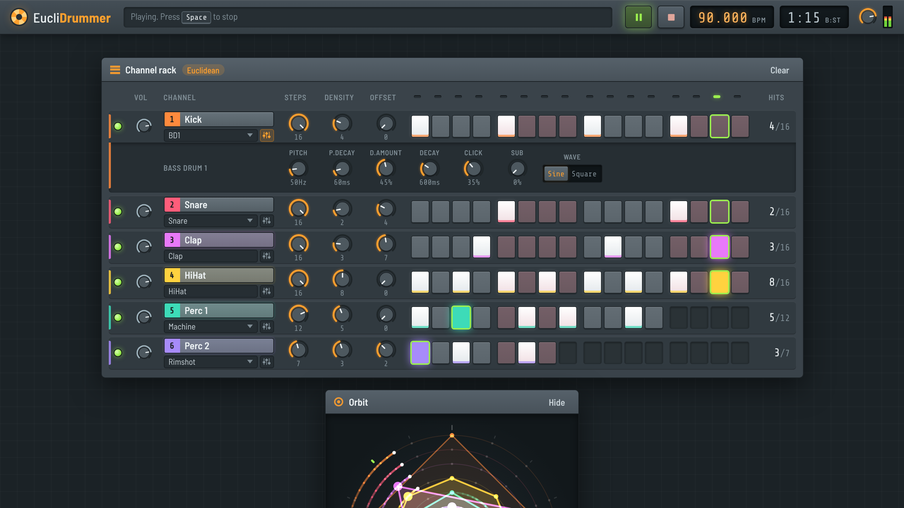

# EucliDrummer



EucliDrummer is a browser drum machine built on the Web Audio API, with no libraries. It generates rhythms with the [Euclidean algorithm](https://en.wikipedia.org/wiki/Euclidean_rhythm): you pick how many steps a pattern has and how many hits to spread across them, and the hits are distributed as evenly as possible. From there you can rotate the pattern, toggle individual steps by hand, shape each drum's sound, and change the tempo while it plays. Every sound is synthesized live in the browser with the Web Audio API, so there are no samples to load.

## Features

- Six tracks: Kick, Snare, Clap, HiHat, Perc 1 and Perc 2, each played by a drum synthesizer modelled on the analog voices of the [Erica Synths HexDrums](https://www.ericasynths.lv/media/HexDrums_manual.pdf).
- A dark, DAW-style interface inspired by FL Studio's channel rack, with rotary knobs, lit step pads, a running playhead and a tempo display.
- Per-track Euclidean controls:
  - **Steps** sets the pattern length (0 to 16 steps).
  - **Density** sets how many hits are spread across those steps (0 to 16, capped at the step count).
  - **Offset** rotates the pattern by 0 to 16 steps.
- 16 step pads per track that show the pattern and light up as the playhead passes. Click a pad to toggle that step.
- Orbit, a live geometric view of the sequence: each track is a ring with its hits joined into an outlined shape with a soft fill and its rests shown as faint dots, and a small ring marks each track's current step, filling in when it plays a hit. It sits beside the rack on wide screens and below it on smaller ones, and **Hide** in its title bar folds it away.
- A HexDrums-style drum synth panel below the rack, always in view, with one module per track holding the knobs and switches from that voice's HexDrums panel (see [The drum synths](#the-drum-synths)). Each module's LED flashes on every hit, and clicking its header plays the drum.
- A voice picker under the track name: Kick can use either bass drum, Snare can switch to the Machine, and the Perc tracks choose between the Machine, the Rimshot and Bass Drum 2. Each voice remembers its settings when you switch away and back. Click the track name to hear it.
- Per-track mute and volume, and a master volume with a level meter.
- Tempo from 40 to 240 BPM (90 by default), adjustable while the loop runs.
- Starts with a ready-to-play groove, and works on phone-sized screens.
- Tracks can have different lengths, so polyrhythms fall out naturally.

## Getting started

There is no build step and nothing to install: the whole app is a handful of small files.

Because the drums are synthesized rather than loaded from files, you can open `index.html` straight from disk. Serving the folder with any static web server works too, for example from the repo folder:

```sh
python3 -m http.server 8000
# or
npx serve .
```

Then open <http://localhost:8000> in your browser. In VS Code, the Live Server extension does the same job.

## How to use it

1. Press **Space** or the green play button to start the loop. Space again stops it; the play button pauses. Browsers only allow audio after you interact with the page, and either of these counts.
2. Turn a track's **Density** knob to add or remove hits. Each track starts with a groove loaded, and **Clear** in the rack's title bar empties every pattern.
3. Turn **Steps** to make a track loop over fewer steps, and **Offset** to shift where its hits land. Tracks with different step counts drift against each other, which is where the polyrhythms come from.
4. Click pads to add or remove individual hits on top of the generated pattern. Hits you add by hand light up blue instead of white, and generated hits you remove get a blue outline, so you can always tell your edits apart from the Euclidean pattern.
5. Pick a voice from a track's dropdown, then shape the sound with that track's knobs and switches in the drum synth panel below the rack. Use the green light to mute a track, and the small knob beside it for its volume.
6. Set the speed by dragging the **BPM** display up or down, scrolling over it, or focusing it and using the arrow keys. Double-click it to go back to 90.

Knobs work the same way: drag up or down (hold Shift for finer steps), scroll, or use the arrow keys, and double-click to return to the starting value. Switches are clicked, or moved with the arrow keys.

Turning a track's Steps, Density or Offset knob regenerates that track's pattern, which replaces any steps you toggled by hand.

## The drum synths

Each voice is a small Web Audio patch in `synths.js`, built fresh for every hit and modelled on one of the eight analog voices of the Erica Synths HexDrums. Control names follow the HexDrums front panel; per-voice LEVEL is the volume knob on each track. The HexDrums' two cymbals are sample-based, so they're left out.

| Voice | How it's made | Controls |
| --- | --- | --- |
| BD1 (Bass drum 1) | A VCO with a pitch envelope, a click and a square sub-oscillator an octave down | **Pitch**, **P.Decay** (pitch envelope time), **D.Amount** (pitch envelope depth), **Decay**, **Click**, **Sub**, **Wave** (Sine / Square) |
| BD2 (Bass drum 2) | An 808-style damped sine | **Pitch**, **Decay**, **Tone** (lowpass on the attack) |
| Snare | A shell of two sine oscillators plus "snappy" noise through a 12 dB/oct filter | **Shell** (pitch), **Tone** (blends the two shell oscillators), **Decay** (snappy length, up to 3 s), **Cutoff**, **Filter** (HP / BP), **Reso** (Low / Mid / Up), **Shell/Snap** |
| Machine | Two triangle "membrane" oscillators with a shared pitch envelope, plus tuned noise | **Pitch**, **Detune** (membrane 2 ratio), **Mem 1**, **Mem 2**, **P.Decay**, **D.Amount**, **Mem Decay**, **Click**, **N.Pitch**, **N.Decay**, **N.Level** |
| Clap | Clocked noise through a resonant bandpass, retriggered in a quick burst, with a simulated reverb | **Pitch** (noise clock, crunchy to white), **Sustain**, **Cutoff**, **Filter** (On / Off), **Reverb** (Off / Pre-filter / Post-filter), **Rev Decay** |
| Rimshot | Three pinged oscillators into a resonant filter swept by the envelope | **Pitch**, **Mode** (Hi / Low / Clave), **Mod Decay**, **Cutoff**, **Reso**, **Filter** (LP / HP / BP), **F.Mod** (bipolar cutoff sweep) |
| HiHat | 808-style metallic squares mixed with noise, through a resonant bandpass | **Hat** (Closed / Open), **OH Decay** (open hat only; the closed hat is fixed and short), **Cutoff**, **Filter** (On / Off) |

All six tracks feed a gentle limiter before the master output, so stacked hits don't clip.

## How the Euclidean patterns work

A Euclidean rhythm E(k, n) places k hits across n steps as evenly as possible. E(3, 8), for example, gives `x . . x . . x .`, the tresillo rhythm, and E(5, 8) gives the cinquillo. Many traditional rhythms from around the world turn out to be Euclidean patterns, which is why a single "density" control produces musical results so easily.

EucliDrummer stores these patterns as a precomputed lookup table (`EUCLID` in `sketch.js`), indexed by step count and then by number of hits. The Offset knob rotates the selected pattern, and a small sequencer schedules every sixteenth note slightly ahead on the audio clock, so timing stays tight. Each track loops over its own pattern length and triggers its synth on each hit; the tempo display, the play button and the Space key control that sequencer.

## Project structure

| Path | What it is |
| --- | --- |
| `index.html` | The page: toolbar, transport and the channel rack shell. Loads the scripts. |
| `sketch.js` | The app: the track table, the Euclidean pattern table, playback, and building the channel rack and the drum synth panel. |
| `synths.js` | The drum voices: each one's panel controls and Web Audio patch. |
| `knob.js` | The rotary knob used for every knob on the page, and the multi-position switch used in the drum synth panel. |
| `visualizer.js` | Orbit, the canvas view that draws each track as a ring and animates it with playback. |
| `style.css` | The FL Studio-inspired theme, including the phone layout. |
| `docs/screenshots/` | Screenshots used in this README. |

## Changing a voice or a track

Each voice in `VOICES` in `synths.js` lists its `controls` and has a `play` function that builds the sound. To add a knob, add a control with `min`, `max`, `step`, `unit` and `default` and read its value in `play`; a control with `options` becomes a switch instead. Tracks are listed in `TRACKS` in `sketch.js`: each names the voices its dropdown offers, the one it starts on, and optional `sounds` that retune a voice's starting values for that track.
